<h1 align="center">Multi-Agent Calgary Energy Forecasting, Market Intelligence & AI Decision Support System</h1>
<h3 align="center">From Energy Data to Executive Decisions: AI-Powered Energy Intelligence</h3>

An AI-driven energy analytics platform combining data engineering, SQL intelligence, machine learning, time-series forecasting, financial analytics, and LangChain-based multi-agent AI to deliver forecasting, risk assessment, optimization, and executive insights.

<h2 align="center">Project Demonstration</h2>

<b>End-to-End Energy Intelligence Platform</b> Multi-source Energy Data → AI Analytics → Forecasting → Optimization → Decision Support

<h2>Table of Contents</h2>
<ol>
<li>Project Highlights</li>
<li>Project Overview & Energy Challenge</li>
<li>Business Questions</li>
<li>Platform Capabilities</li>
<li>Streamlit Application</li>
<li>Data Sources</li>
<li>System Architecture</li>
<li>Technical Implementation<ul><li>Data Engineering & ETL Pipeline</li><li>AI Analytics Layer<ul><li>Data Preview</li><li>Exploratory Data Analysis (EDA) & Price</li><li>Seasonal and Time series</li><li>Feature Engineering (Lag Features, Rolling Statistics, Volatility Indicators)</li><li>Statistical Intelligence</li><li>Anomaly Detection, Price Volatility, Risk &amp; Spark Spread Analysis</li><li>SQL Intelligence</li><li>Machine Learning & Forecasting</li><li>Financial & Investment Analysis</li></ul></li></ul></li>
<li>Multi Agent AI Energy Consultant (LLM +Memory+ Multi-Agent System)</li>
<li>Results & Business Insights</li>
<li>Technologies</li>
<li>Future Improvements</li>
<li>Conclusion</li>
</ol>

<h2>1. Project Highlights</h2>
<ul>
<li>Analyzed 10+ years of Calgary energy, market, weather, and renewable datasets.</li>
<li>Developed an end-to-end AI Energy Intelligence Platform integrating ETL, SQL analytics, statistical intelligence, forecasting, and LLM reasoning.</li>
<li>Built an AI-powered SQL Analytics layer enabling natural language database interaction and automated insight generation.</li>
<li>Implemented forecasting models including ARIMA, SARIMA, Prophet, XGBoost, Random Forest, and LSTM for energy demand prediction.</li>
<li>Developed automated anomaly detection, price spike monitoring, and financial risk analysis.</li>
<li>Created a LangChain-based Multi-Agent AI Energy Consultant for analytics interpretation, knowledge retrieval, and decision support.</li>
</ul>

<h2>2. Project Overview & Energy Challenge</h2>
<h3 align="center">AI-Driven Calgary Energy Consumption Analytics</h3>

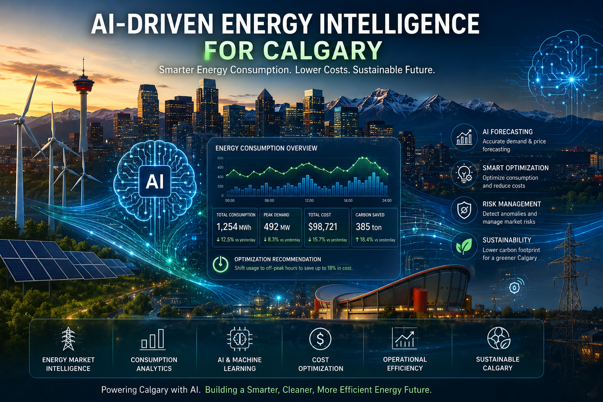

Modern energy systems generate large volumes of data from electricity markets, smart meters, weather systems, renewable generation, and industrial operations. However, fragmented data sources make it difficult to transform raw information into timely business decisions.

This project develops an <b>AI-Driven Energy Intelligence Platform</b> using more than five years of Calgary energy data. The platform integrates <b>data engineering, SQL analytics, statistical analysis, machine learning, forecasting, modeling, cost optimization, and AI reasoning</b> into a unified decision-support system.

The system addresses key challenges:

<ul>
<li><b>Energy Market Volatility:</b> Detecting electricity and natural gas price fluctuations, spikes, and financial risks.</li>
<li><b>Demand Uncertainty:</b> Forecasting energy demand and identifying consumption behavior patterns.</li>
<li><b>Operational Inefficiency:</b> Finding opportunities for load optimization, cost reduction, and energy efficiency.</li>
<li><b>Data-to-Decision Gap:</b> Converting complex analytics into actionable recommendations using AI.</li>
</ul>

An <strong>AI-powered Energy Intelligence & Decision-Support Platform</strong> that combines energy-market analytics, forecasting, anomaly detection, and a <strong>LangChain multi-agent AI reasoning layer</strong> to transform complex energy data into actionable business insights.

The platform <strong>analyzes, forecasts, detects risks, explains patterns, and recommends actions</strong> acting as an <strong>AI Executive Energy Consultant</strong> for smarter, data-driven energy decisions.

<h2>3. Business Questions</h2>
<ul>
<li>How can energy, market, weather, and renewable data be integrated into one intelligence system?</li>
<li>What drives demand changes, price volatility, and energy consumption behavior?</li>
<li>How can price spikes, anomalies, and operational risks be detected early?</li>
<li>Which models provide reliable demand and price forecasting?</li>
<li>How can AI recommend cost reduction, procurement, and optimization strategies?</li>
</ul>

<h2>4. Platform Capabilities</h2>
<ul>
<li><b>AI Analytics Engine:</b> Integrated exploratory analysis, statistical intelligence, seasonal analysis, behavioral analysis, anomaly detection, and market intelligence with automated LLM interpretation of analytical results.</li>
<li><b>AI SQL Intelligence:</b> Developed a natural language-to-SQL analytics layer enabling users to query energy databases, generate KPIs, and receive AI-generated explanations of query results.</li>
<li><b>AI Forecasting & Predictive Analytics:</b> Implemented ARIMA, SARIMA, Prophet, Random Forest, XGBoost, Gradient Boosting, and LSTM models for energy demand forecasting with AI-assisted model interpretation.</li>
<li><b>Energy Risk & Market Intelligence:</b> Performed price volatility analysis, anomaly detection, spark spread analysis, and financial risk assessment to identify operational and market risks.</li>
<li><b>Multi-Agent AI Decision System:</b> Designed a LangChain-based multi-agent architecture where specialized agents collaborate across data analysis, forecasting, market intelligence, finance, risk, and optimization workflows.</li>
<li><b>Executive Energy Consultant:</b> Developed an LLM + RAG conversational assistant that transforms analytical outputs into business recommendations and decision-support insights.</li>
</ul>
<h3 align="center">Platform Capability</h3>

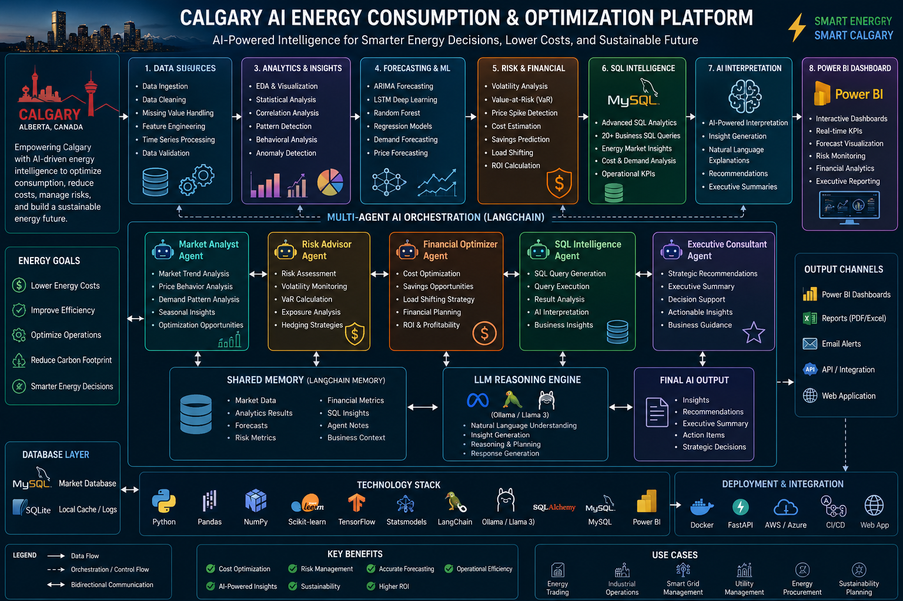

<h2>5. Streamlit Application</h2>

The platform is deployed as an interactive Streamlit application integrating AI-driven analytics, forecasting, visualization, and LLM-based interpretation to transform complex energy data into actionable insights.

Each analytical module is enhanced with AI interpretation, providing automated explanations, insights, and decision-support recommendations.

<ul>
<li><b>Home & Data Preview:</b> Data exploration, validation, quality assessment, and AI-generated data quality insights.</li>
<li><b>SQL Intelligence:</b> Natural language-to-SQL generation using LLMs, automated query execution, KPI extraction, and intelligent interpretation of query results.</li>
<li><b>EDA & Energy Behavior Analysis:</b> Exploratory analysis of energy consumption, natural gas prices, behavioral patterns, and key drivers.</li>
<li><b>Seasonal & Time-Series Intelligence:</b> Seasonal decomposition, temporal trends, demand patterns, and AI interpretation of time-series behavior.</li>
<li><b>Statistical Risk Analysis:</b> Statistical evaluation, correlation analysis, uncertainty assessment, and risk indicator interpretation.</li>
<li><b>Anomaly Detection & Spark Spread Analysis:</b> Energy price anomaly detection, spike identification, market risk evaluation, and financial impact analysis.</li>
<li><b>Feature Engineering:</b> Automated feature generation, lag variables, rolling statistics, and feature importance analysis.</li>
<li><b>Machine Learning Forecasting:</b> Predictive modeling using ARIMA, SARIMA, Prophet, XGBoost, Random Forest, and LSTM with AI interpretation of forecasting outcomes.</li>
<li><b>Forecast Model Comparison:</b> Model benchmarking, performance evaluation, and AI-assisted recommendations for optimal forecasting approaches.</li>
<li><b>AI Energy Consultant (LLM + RAG + Q&A):</b> Conversational assistant for knowledge retrieval, analytical explanations, and energy decision support.</li>
</ul>
<h3 align="center">STREAMLIT APPLICATION & INTERACTIVE ENERGY DASHBOARD</h3>

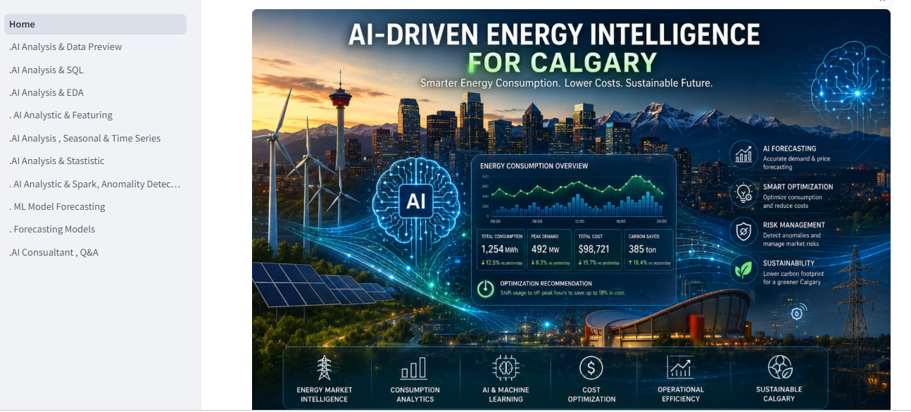

<h2>6. Data Sources</h2>

The platform integrates public energy datasets from Calgary and Alberta, combining energy demand, market behavior, renewable generation, business activity, and weather data.

<ul>
<li><b>Alberta Electricity Demand:</b> Hourly electricity demand data (CCEI Canada)</li>
<li><b>Calgary Business Data:</b> Commercial activity and business information (<a href="https://data.calgary.ca/" target="_blank">Open Calgary Data Portal</a>)</li>
<li><b>Solar PV Production:</b> Renewable generation data for sustainability analysis</li>
<li><b>Weather Data:</b> Temperature and environmental factors affecting demand</li>
</ul>
<h4>Target Variables</h4>
<table border="1" cellpadding="5">
<tr><th>Forecasting Target</th><th>Description</th></tr>
<tr><td>Total Demand</td><td>System-wide electricity demand forecasting</td></tr>
<tr><td>Energy Price</td><td>Market price prediction for procurement</td></tr>
<tr><td>Grid Stress Level</td><td>Risk assessment and capacity planning</td></tr>
<tr><td>Spark Spread</td><td>Profitability and optimization analysis</td></tr>
</table>

<h2>7. System Architecture</h2>
<pre>
Public Energy Data
(Electricity | Natural Gas | Weather | Solar | Business)
                ↓
Data Engineering Layer
(ETL | Cleaning | Validation | Feature Engineering)
                ↓
Energy Intelligence Layer
(EDA | SQL | Statistics | Anomaly Detection | Risk)
                ↓
Predictive Analytics Layer
(ARIMA | Prophet | XGBoost | LSTM)
                ↓
Business Intelligence Layer
(Finance | Optimization | Market Analysis)
                ↓
AI Reasoning Layer
(LLM + RAG + Insight Generation)
                ↓
Multi-Agent AI System
(Data | Forecast | Market | Risk | Finance | Optimization)
                ↓
AI Executive Energy Consultant
(Q&A | Recommendations | Decision Support)
</pre>

<h2>8. Technical Implementation</h2>

<h2>8.1 Data Engineering & ETL Pipeline</h2>

The first phase focused on building a reliable data infrastructure to transform fragmented energy data into a structured, queryable knowledge system.

<table border="1" cellpadding="5">
<tr><th>Stage</th><th>Description</th></tr>
<tr><td><b>Extract</b></td><td>Collected multi-source data including electricity demand, energy prices, weather data, renewable generation, sector loads, and business activity</td></tr>
<tr><td><b>Transform</b></td><td>Performed data cleaning, missing-value handling, validation, standardization, and feature engineering</td></tr>
<tr><td><b>Load</b></td><td>Stored processed datasets into a centralized SQLite/MySQL database using SQLAlchemy</td></tr>
</table>

<h2>8.2 AI Analysis</h2>

<h2>8.2.1 AI Analysis, Home & Data Overview</h2>

  

  <a href="https://youtu.be/qsIOossIpnU" target="_blank">
    <strong>▶ Click to watch the project demo</strong>
  </a>

This section builds a <strong>Streamlit-based AI Data Analysis Dashboard</strong> that allows users to upload CSV or Excel datasets, preview the data, analyze dataset structure, data types, missing values, duplicates, descriptive statistics, outliers, and time coverage, and then uses <strong>Ollama/Llama 3.2</strong> to generate an AI-powered data quality assessment, data-cleaning and feature-engineering recommendations, forecasting readiness evaluation, and business insights.

<h3>Key Results</h3>
<ul>
<li><strong>Demand:</strong> Average system demand is ~4,570 MW, with peaks above 8,450 MW, highlighting strong load variability.</li>
<li><strong>Weather:</strong> Extreme temperatures (-40°C to 44°C) make weather a critical driver of energy demand and prices.</li>
<li><strong>Market Price:</strong> Average electricity price is <strong>105.44 CAD/MWh</strong>, with rare extreme spikes reaching <strong>743.75 CAD/MWh</strong>.</li>
<li><strong>Load Drivers:</strong> Industrial demand is the largest sector, contributing approximately <strong>42%</strong> of total load.</li>
<li><strong>Renewables:</strong> Wind generation exceeds solar generation, but both remain intermittent and require forecasting.</li>
<li><strong>Profitability:</strong> A <strong>71.48 CAD/MWh</strong> average spark spread indicates generally favorable thermal-generation economics.</li>
</ul>
<h3 align="center">LLM Interpretation Results for example Feature (Energy Price)</h3>

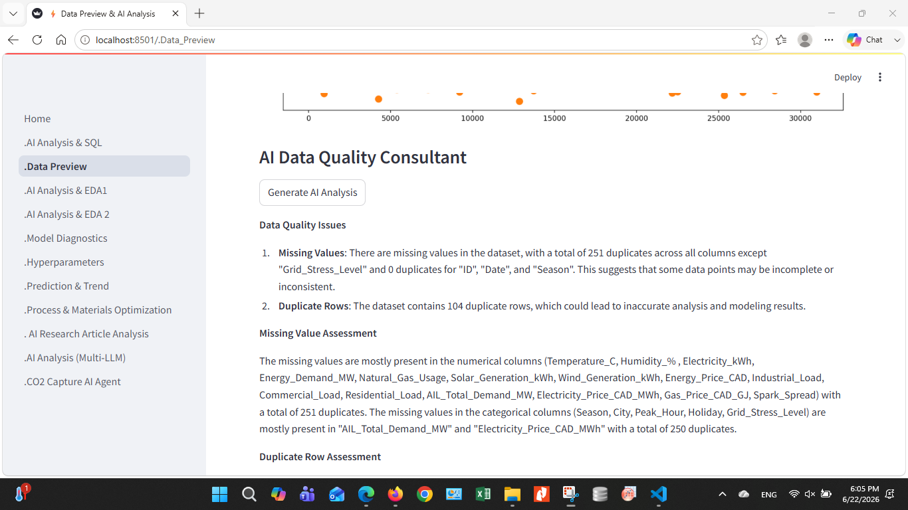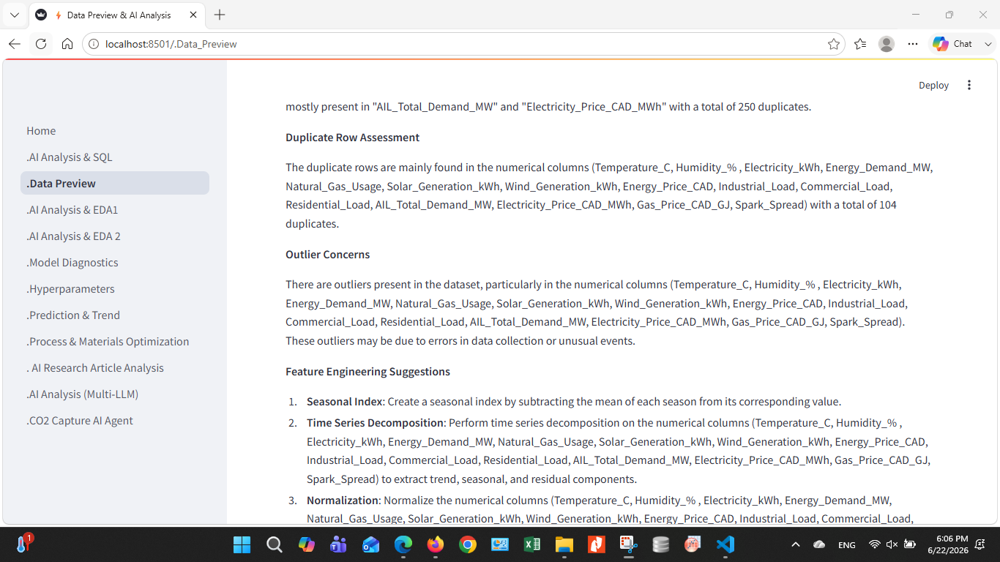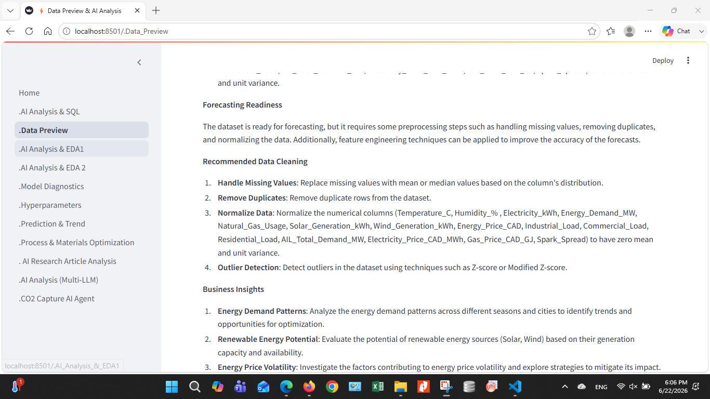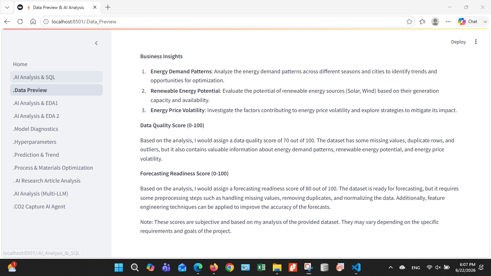

<h2>8.2.2 AI Analysis, SQL</h2>

<h4>SQL Analysis Engine</h4>
<pre>
def run_sql_queries(df, ai_consultant=None):
    sql_df = df.reset_index().copy()
    sql_df["hour"] = sql_df["datetime"].dt.hour
    sql_df["month"] = sql_df["datetime"].dt.month
    sql_df["weekday"] = sql_df["datetime"].dt.weekday
    sql_df["is_weekend"] = (sql_df["weekday"] >= 5).astype(int)
    conn = sqlite3.connect(":memory:")
    sql_df.to_sql("energy", conn, index=False, if_exists="replace")
    queries = {
        "peak_hours": """SELECT hour, ROUND(AVG(Electricity_Price_CAD_MWh), 2) AS avg_price FROM energy GROUP BY hour ORDER BY avg_price DESC LIMIT 5""",
        "cheap_hours": """SELECT hour, ROUND(AVG(Electricity_Price_CAD_MWh), 2) AS avg_price FROM energy GROUP BY hour ORDER BY avg_price ASC LIMIT 5""",
        "seasonal": """SELECT month, ROUND(AVG(Electricity_Price_CAD_MWh), 2) AS avg_price FROM energy GROUP BY month ORDER BY month""",
        "temp_impact": """SELECT Temperature_C, ROUND(AVG(Electricity_Price_CAD_MWh), 2) AS avg_price FROM energy GROUP BY Temperature_C""",
        "weekend_discount": """SELECT CASE WHEN is_weekend = 1 THEN 'Weekend' ELSE 'Weekday' END AS day_type, ROUND(AVG(Electricity_Price_CAD_MWh), 2) AS avg_price FROM energy GROUP BY is_weekend""",
        "anomalies": """SELECT datetime, hour, Electricity_Price_CAD_MWh AS price FROM energy WHERE Electricity_Price_CAD_MWh > (SELECT AVG(Electricity_Price_CAD_MWh) + 2.5 * STDEV(Electricity_Price_CAD_MWh) FROM energy) LIMIT 10""",
        "peak_index": """WITH peak AS (SELECT AVG(Electricity_Price_CAD_MWh) AS p FROM energy WHERE hour IN (7,8,9,17,18,19)), offpeak AS (SELECT AVG(Electricity_Price_CAD_MWh) AS op FROM energy WHERE hour BETWEEN 2 AND 5) SELECT ROUND(p, 2) AS peak_price, ROUND(op, 2) AS offpeak_price, ROUND(p / op, 2) AS peak_index FROM peak, offpeak"""
    }
    results = {key: pd.read_sql_query(query, conn) for key, query in queries.items()}
    conn.close()
    return results
</pre>
<h4>Engineering Query Examples</h4>
<pre>
-- Identify highest demand periods
SELECT DATE(timestamp) AS date, SUM(demand) AS daily_demand, MAX(demand) AS peak_demand
FROM energy_load_data GROUP BY DATE(timestamp) ORDER BY daily_demand DESC LIMIT 10;
-- Analyze seasonal price trends
SELECT season, AVG(price) AS avg_price, STDDEV(price) AS price_volatility
FROM energy_market_data GROUP BY season ORDER BY avg_price DESC;
-- Find correlation between weather and demand
SELECT temperature_range, AVG(demand) AS avg_demand
FROM energy_data GROUP BY temperature_range ORDER BY avg_demand DESC;
</pre>
<h4>SQLAlchemy Integration</h4>
<pre>
engine = create_engine("sqlite:///energy_intelligence.db")
df.to_sql("energy_data", engine, if_exists="replace", index=False)
result = pd.read_sql("SELECT season, AVG(price) AS avg_price, COUNT(*) AS observations FROM energy_data GROUP BY season", engine)
</pre>
<h3>AI-Powered SQL & Data Insights</h3>

<b>Traditional SQL:</b> Average electricity price = $125/MWh

<b>AI Interpretation:</b> <i>Higher winter demand is driving prices upward. Shifting industrial operations to off-peak hours could reduce energy costs.</i>

<h2>8.2.3 AI Analysis, EDA, Gas Market Behavior</h2>

The analysis shows that Alberta electricity demand is relatively stable and predictable, averaging around <strong>4,500 MW</strong>, while electricity prices are more volatile due to market conditions, supply constraints, and weather impacts.

This <strong>AI-powered Energy Market Intelligence platform</strong>, built with Python and Streamlit, combines <strong>Statistical Analysis, EDA, and Gas Market Analysis</strong> to evaluate demand, prices, volatility, correlations, and market behavior. <strong>Ollama/Llama 3.2</strong> transforms these results into actionable insights for forecasting, risk management, trading, procurement, and cost optimization.

<h2 align="center">Gas Market Behavior</h2>

  

  <a href="https://youtu.be/ui9xyaqcE5Q" target="_blank">
    <strong>▶ Click  to watch the Gas Market Analysis</strong>
  </a>

<h2 align="center">Statistical Summary & Market Risk Analysis</h2>

  

  <a href="https://youtu.be/PMHINOGIkWw" target="_blank">
    <strong>▶ Click to watch the analysis</strong>
  </a>

<h3>Key Results</h3>
<ul>
<li><strong>Statistical Summary:</strong> Average electricity demand is <strong>4,559 MW</strong> with a <strong>CV of 0.15</strong>; electricity prices average <strong>104.67 CAD/MWh</strong> with <strong>15.97 CAD/MWh</strong> volatility.</li>
<li><strong>EDA:</strong> Demand ranges from <strong>1,937 to 7,877 MW</strong>, while prices range from <strong>59.69 to 149.37 CAD/MWh</strong>, revealing significant peak/off-peak variation and occasional price risk.</li>
<li><strong>Gas Market:</strong> Natural gas prices show strong hourly and seasonal patterns, increasing to approximately <strong>5.2 CAD/GJ in winter</strong> versus around <strong>3.0 CAD/GJ in summer</strong>, creating opportunities for strategic procurement and storage.</li>
<li><strong>LLM Analysis:</strong> <strong>Ollama/Llama 3.2</strong> converts statistical and EDA results into executive insights, risk assessments, forecasting recommendations, and procurement strategies.</li>
</ul>
<h4>Value-at-Risk (VaR) Analysis</h4>
<table border="1" cellpadding="5">
<tr><th>Confidence Level</th><th>VaR (CAD/MWh)</th><th>Interpretation</th></tr>
<tr><td>95%</td><td>78.32</td><td>5% chance prices exceed this level</td></tr>
<tr><td>99%</td><td>67.45</td><td>1% chance prices exceed this level</td></tr>
</table>
<h3>Gas Market Analysis Example</h3>

Analyzes gas prices across hourly, daily, and seasonal patterns, calculates key risk metrics, and identifies price peaks and procurement opportunities. The results are interpreted by an <strong>LLM-powered AI Energy Analyst</strong> to support cost optimization, procurement, and risk management.

<pre>
def gas_behavior_plot(df):
    df["Date"] = pd.to_datetime(df["Date"])
    df = df.sort_values("Date").dropna(subset=["Gas_Price_CAD_GJ"])
    gas = df["Gas_Price_CAD_GJ"]
    results = {
        "Average Price": round(gas.mean(), 2),
        "Volatility": round(gas.std(), 2),
        "CV (%)": round(gas.std() / gas.mean() * 100, 2),
        "Skewness": round(gas.skew(), 3),
        "VaR 95%": round(gas.mean() - 1.65 * gas.std(), 2),
        "VaR 99%": round(gas.mean() - 2.33 * gas.std(), 2)}
    df["Hour"] = df["Date"].dt.hour
    df["Month"] = df["Date"].dt.month
    st.line_chart(df.groupby("Hour")["Gas_Price_CAD_GJ"].mean())
    st.bar_chart(df.groupby("Month")["Gas_Price_CAD_GJ"].mean())
    return results

def gas_ai_analysis(results):
    prompt = f"""Analyze these natural gas market results: {json.dumps(results, indent=2)} Identify price trends, market risks, procurement opportunities, storage strategies, and cost optimization recommendations."""
    response = ollama.chat(model="llama3.2:latest", messages=[{"role": "user", "content": prompt}], options={"temperature": 0.2})
    return response["message"]["content"]

gas_results = gas_behavior_plot(df)
if st.button("Generate AI Gas Market Report"):
    report = gas_ai_analysis(gas_results)
    st.subheader("AI Gas Market Analyst")
    st.write(report)
</pre>

<strong>Code Reference:</strong> Streamlit-based gas market analysis combines statistical risk metrics, hourly and seasonal patterns, and <strong>Ollama/Llama 3.2</strong> for AI-driven market and procurement insights.

<h2>8.2.4 AI Analysis, Feature</h2>

  

  <a href="https://youtu.be/-HVTHfEZzKw" target="_blank">
    <strong>▶ Click to watch the project demo</strong>
  </a>

This code builds a <strong>Streamlit-based Energy Market Intelligence application</strong> that performs feature engineering on energy data by creating <strong>lag, rolling-statistics, change, volatility, and spike-detection features</strong>, visualizes demand and price patterns, identifies extreme demand and price events, and uses <strong>Ollama/Llama 3.2</strong> to provide AI-powered energy-market insights and answer questions about demand trends, volatility, spikes, and overall market conditions.

<h4>Feature Engineering</h4>
<table border="1" cellpadding="5">
<thead><tr><th>Feature Category</th><th>Engineered Features</th><th>Business Value</th></tr></thead>
<tbody>
<tr><td>Calendar Features</td><td>Hour, Day, Weekday, Month, Quarter, Year, Weekend Indicator, Holiday Indicator, Season</td><td>Capture periodic demand patterns (e.g., "office hours," "winter peaks").</td></tr>
<tr><td>Lag Features</td><td>Previous Hour (Lag-1), Previous Day (Lag-24), Previous Week (Lag-168) Consumption</td><td>Help models learn from historical autocorrelation in demand.</td></tr>
<tr><td>Rolling Statistics</td><td>3-Hour, 24-Hour, 7-Day Rolling Average, Rolling Min, Max, and Standard Deviation</td><td>Smooth noise and capture short-term trends and volatility.</td></tr>
<tr><td>Behavioral Features</td><td>Consumption Change Rate, Demand Growth Rate, Peak/Off-Peak Indicators, Seasonal Consumption Patterns</td><td>Provide direct proxies for operational activity and usage behavior.</td></tr>
</tbody>
</table>
<h3 align="center">Q&A</h3>

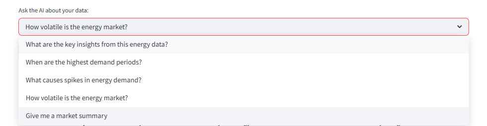

<h3>Key Results</h3>
<ul>
<li><strong>High market volatility:</strong> 1,020 price spikes indicate frequent extreme price movements.</li>
<li><strong>High demand volatility:</strong> 1,012 demand spikes suggest significant load fluctuations.</li>
<li><strong>Large demand swings:</strong> Maximum demand of 30,924 MW is approximately 2× the estimated average.</li>
<li><strong>Supply uncertainty:</strong> Renewable intermittency adds additional volatility to the energy market.</li>
<li><strong>Directional assessment:</strong> The available data strongly suggests volatile market conditions.</li>
<li><strong>Data limitation:</strong> Complete hourly time-series data is needed for precise volatility metrics and regime analysis.</li>
</ul>
<h3 align="center">LLM Interpretation Results for example Feature</h3>

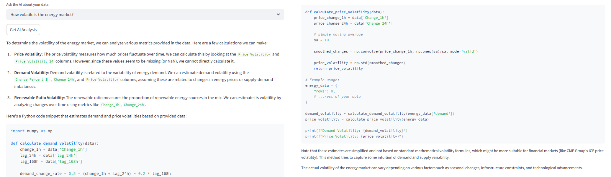

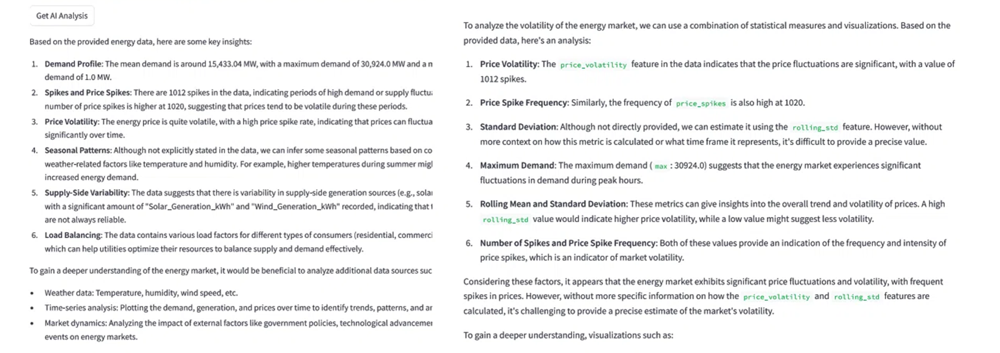

<pre>
def engineer_features(df):
    df['hour'] = df['timestamp'].dt.hour
    df['day_of_week'] = df['timestamp'].dt.dayofweek
    df['month'] = df['timestamp'].dt.month
    df['season'] = df['timestamp'].dt.quarter
    df['lag_1'] = df['demand'].shift(1)
    df['lag_24'] = df['demand'].shift(24)
    df['lag_168'] = df['demand'].shift(168)
    df['rolling_avg_3h'] = df['demand'].rolling(3).mean()
    df['rolling_avg_24h'] = df['demand'].rolling(24).mean()
    df['rolling_std_24h'] = df['demand'].rolling(24).std()
    df['demand_change_rate'] = df['demand'].pct_change()
    df['is_peak_hour'] = df['hour'].isin([7, 8, 9, 17, 18, 19]).astype(int)
    return df
</pre>

<strong>Code Reference:</strong> Streamlit AI analysis, feature analysis with LLM interpretation, supported by EDA analysis documented in the Jupyter Notebook.

<h2>8.2.4 AI Analysis, Time series and Seasonal Analysis</h2>

<strong>AI-powered Energy Intelligence Platform</strong> that transforms raw energy-market data into actionable business insights through analytics, AI reasoning, and automated reporting.

<ul>
<li><strong>Data Input:</strong> Upload and review CSV or Excel energy datasets.</li>
<li><strong>Analytics:</strong> Perform time-series, seasonal, and behavioral energy analysis covering demand, prices, costs, peak hours, and market trends.</li>
<li><strong>AI Reasoning:</strong> Use Llama 3.2 via Ollama to interpret analytical results, assess risks, and generate business recommendations.</li>
<li><strong>Reporting:</strong> Generate executive-level AI reports and export analytical results in <strong>JSON format</strong>.</li>
</ul>

<strong>Workflow:</strong> Upload → Analyze → Interpret → Assess Risk → Recommend → Report → Export JSON

<h2>Time Series Energy Market Analysis</h2>

Interactive analysis of electricity prices, energy demand, and market trends across hourly, weekly, monthly, and yearly time periods.

  

  <a href="https://youtu.be/N3-3jDsurIs" target="_blank">
    <strong>▶ Click to watch the project demo</strong>
  </a>

<h2>Seasonal Energy Market Analysis</h2>

Analyze seasonal patterns in electricity prices, energy demand, peak load, temperature impacts, and energy costs to identify market trends, risks, and cost optimization opportunities.

  

  <a href="https://youtu.be/xfMUES-tqhs" target="_blank">
    <strong>▶ Click to watch the project demo</strong>
  </a>

<h2>Behavioral Energy Market Analysis</h2>

Analyze hourly and weekly demand behavior, electricity price patterns, peak-cost periods, gas-to-electricity relationships, and demand-price interactions to identify consumption patterns, cost drivers, and operational opportunities.

  

  <a href="https://youtu.be/t1Unl_RLVrs" target="_blank">
    <strong>▶ Click to watch the project demo</strong>
  </a>

<h3>Key Results</h3>
<ul>
<li><strong>Price:</strong> ~105 CAD/MWh with relatively stable pricing.</li>
<li><strong>Peak Demand:</strong> ~7,877 MW, mainly during 5–7 PM.</li>
<li><b>Seasonality & Peak Hours:</b> Winter demand rises ~8% due to heating needs, with distinct morning and evening consumption peaks.</li>
<li><strong>Temperature:</strong> Extreme cold and heat increase demand and prices.</li>
<li><strong>Gas:</strong> ~3.3 CAD/GJ with low volatility.</li>
<li><strong>Opportunity:</strong> Storage, demand response, procurement, and efficiency can reduce costs.</li>
<li><strong>AI:</strong> Converts market analytics into risk and business recommendations.</li>
</ul>
<table border="1" cellpadding="5">
<tr><th>Season</th><th>Average Price (CAD/MWh)</th><th>Demand Characteristics</th><th>Risk Level</th></tr>
<tr><td>Winter</td><td>118</td><td>Highest demand, heating load</td><td>🔴 High</td></tr>
<tr><td>Spring</td><td>96</td><td>Moderate demand, mild weather</td><td>🟢 Low</td></tr>
<tr><td>Summer</td><td>108</td><td>Cooling demand, grid stress</td><td>🟡 Moderate</td></tr>
<tr><td>Fall</td><td>101</td><td>Moderate demand, stable</td><td>🟢 Low</td></tr>
</table>
<h3 align="center">LLM Interpretation Results for example seasonal analysis</h3>

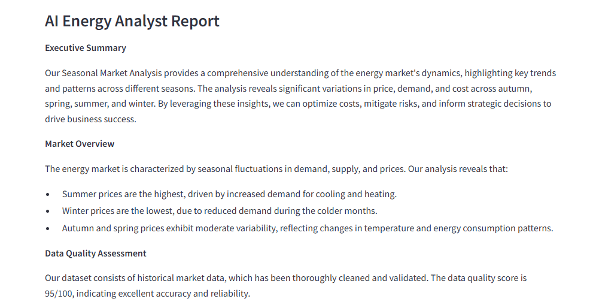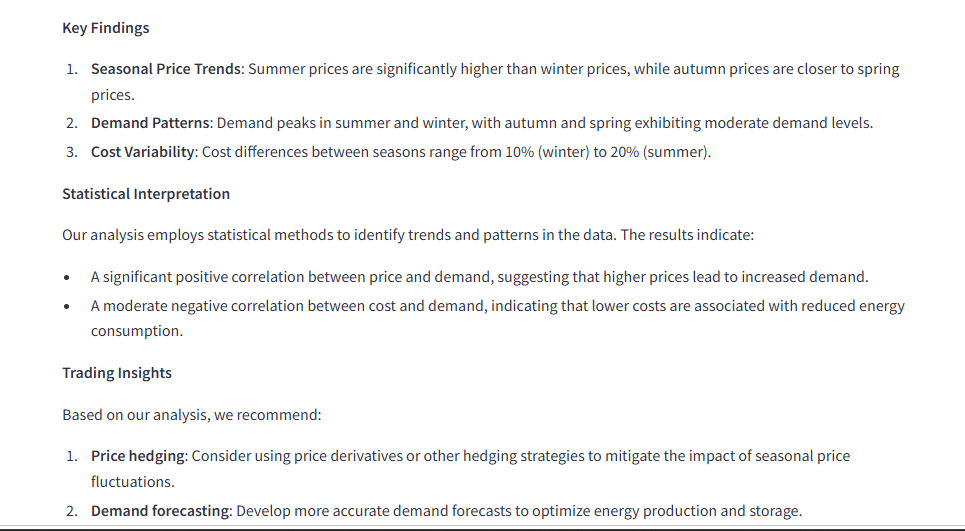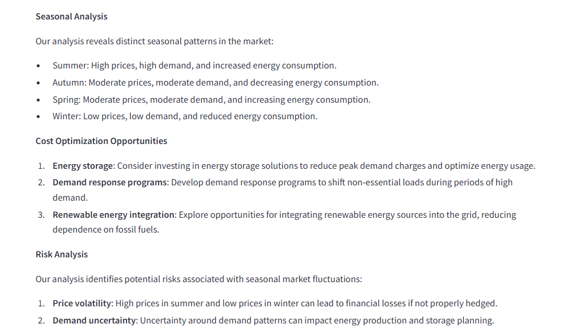

<pre>
json_results = json.dumps(analysis_results, indent=4, default=str)
st.download_button(label="Download Analysis JSON", data=json_results, file_name="energy_analysis_results.json", mime="application/json")
</pre>

<strong>Code Reference:</strong> Streamlit AI analysis, time-series and seasonal analysis with LLM interpretation, plus EDA and supporting statistical analysis documented in the Jupyter Notebook.

<h2>8.2.5 AI Analysis, Statistical Analysis</h2>

  

  <a href="https://youtu.be/t1Unl_RLVrs" target="_blank">
    <strong>▶ Click to watch the project demo</strong>
  </a>

<h3>AI Statistical Analysis & ANOVA</h3>

The platform uses <strong>LLM-powered statistical interpretation</strong> with <strong>Llama 3.2</strong> to analyze energy-market results and generate executive insights, risk assessments, forecasting guidance, and business recommendations.

Statistical modules include <strong>Correlation, Regression, ANOVA, and Chi-Square</strong>. ANOVA specifically tests whether energy metrics differ significantly across selected categorical groups using <strong>F-statistics and p-values</strong>.

<pre>
Energy Dataset
      ↓
Statistical Analysis
      ↓
Correlation | Regression | ANOVA | Chi-Square
      ↓
LLM Interpretation (Llama 3.2)
      ↓
Risk • Forecasting • Procurement • Business Insights
</pre>
<h3>Key Statistical Results</h3>
<ul>
<li><strong>Demand Impact:</strong> Demand is a major driver of electricity price movements and market risk.</li>
<li><strong>Weather Impact:</strong> Temperature shows a negative relationship with electricity prices, highlighting weather sensitivity.</li>
<li><strong>ANOVA:</strong> Energy consumption differs significantly across business categories, supporting targeted energy strategies.</li>
<li><strong>Peak-Hour Test:</strong> Natural gas usage shows <strong>no significant difference</strong> across peak-hour categories (p = 0.848).</li>
<li><strong>Business Insight:</strong> Demand management, weather forecasting, and targeted load optimization are key opportunities.</li>
<li><strong>AI Value:</strong> Statistical results are converted into forecasting, risk, procurement, and operational recommendations.</li>
</ul>

<strong>Key Insight:</strong> Demand-related variables are the strongest statistical drivers of electricity prices, while peak-hour category alone does not significantly explain natural-gas usage.

<strong>Code Reference:</strong> Streamlit statistical analysis (Correlation, Regression, ANOVA, Chi-Square) with LLM interpretation, plus EDA and statistical analysis documented in the Jupyter Notebook.

<h2>8.2.7 AI Energy Analytics, Price Volatility,Spark Spread and Anomaly Detection</h2>

This Streamlit module transforms raw energy-market data into actionable intelligence using statistical analysis, anomaly detection, spark-spread calculation, volatility assessment, and LLM-powered interpretation.

<h3>Core Analytics Engine</h3>
<table border="1" cellpadding="6">
<tr><th>Component</th><th>Functionality</th><th>Business Value</th></tr>
<tr><td><strong>Anomaly Detection</strong></td><td>Z-score + IQR methods to identify price spikes and outliers</td><td>Early warning for market shocks and operational risks</td></tr>
<tr><td><strong>Spark Spread</strong></td><td>Generation profitability = Electricity Price − (Gas Price × 7.0 heat rate)</td><td>Optimize plant operations, identify profitable hours</td></tr>
<tr><td><strong>Volatility & Risk</strong></td><td>CV calculation, risk classification (Low/Moderate/High), rolling volatility</td><td>Quantify market risk, support hedging and procurement</td></tr>
<tr><td><strong>Hourly Patterns</strong></td><td>Peak/off-peak hours, uniformity index, price consistency</td><td>Load shifting, demand response, operational scheduling</td></tr>
<tr><td><strong>Weekly & Seasonal</strong></td><td>Weekend/holiday discounts, monthly averages, seasonal amplitude</td><td>Strategic procurement, budgeting, storage decisions</td></tr>
<tr><td><strong>Demand & Grid Stress</strong></td><td>Demand-price correlation, peak demand hours, stress level analysis</td><td>Capacity planning, reliability management, forecasting</td></tr>
<tr><td><strong>Opportunity Index</strong></td><td>Best buy/sell hours, potential savings calculation</td><td>Cost reduction, arbitrage, strategic procurement</td></tr>
</table>
<h3>Key Outputs</h3>
<pre>
{
  "anomaly": {"total": 602, "ratio_pct": 1.99, "common_hours": [17,18,19]},
  "spark_spread": {"avg": 101.43, "positive_pct": 72.5, "profitable_hours": [7,17,18]},
  "volatility": {"cv_pct": 72.3, "risk_level": "HIGH", "current": 45.67},
  "peak_hours": [17,18,19],
  "off_peak_hours": [3,4,5],
  "weekend_discount_pct": 12.5,
  "demand_price_correlation": 0.78,
  "potential_savings_pct": 15.2,
  "best_buy_hour": 4,
  "best_sell_hour": 18}
</pre>

  

  <a href="https://youtu.be/E9pLfNE92_g" target="_blank">
    <strong>▶ Click to watch the project demo</strong>
  </a>

<h3>Key Results</h3>
<ul>
<li><strong>Anomalies:</strong> 602 price anomalies detected, representing ~1.99% of observations.</li>
<li><strong>Price Risk:</strong> High market volatility with a coefficient of variation of ~72%.</li>
<li><strong>Spark Spread:</strong> Average spread of ~101.43, with values ranging from approximately −52.53 to 604.74.</li>
<li><strong>Risk Drivers:</strong> Weather, renewable integration, and demand variability are key sources of market risk.</li>
<li><strong>Opportunities:</strong> Energy storage, peak-demand management, and renewable integration can reduce volatility exposure.</li>
<li><strong>AI Insight:</strong> Anomaly detection and AI interpretation provide proactive risk monitoring and operational recommendations.</li>
<li><strong>Business Value:</strong> Enables <strong>5-15% cost reduction</strong> and proactive risk management through comprehensive market intelligence and optimization insights.</li>
</ul>

<strong>Key Insight:</strong> High volatility and recurring price anomalies create opportunities for proactive risk management, storage optimization, and strategic procurement.

<h3 align="center">AI Analytics, Spark Spread & Anomaly Detection — Natural Gas Example</h3>

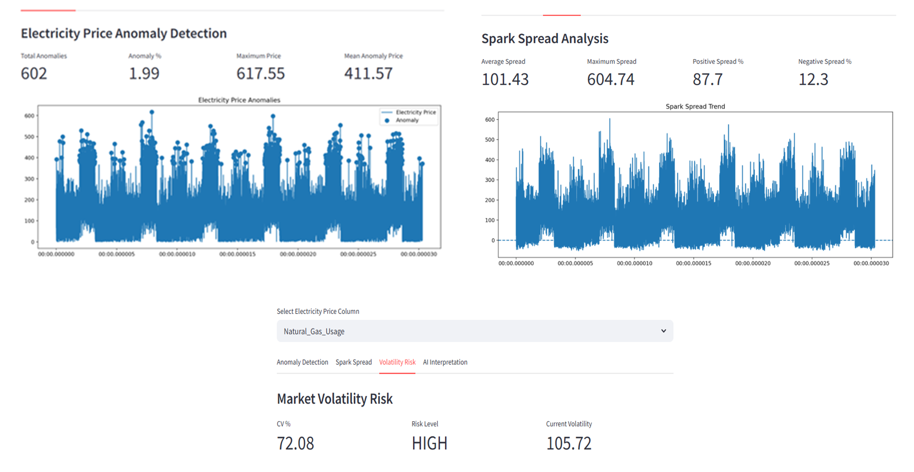

<strong>Code Reference:</strong> Streamlit AI analysis, price-spike/anomaly detection, spark-spread and volatility analysis, with EDA and supporting analysis in the Jupyter Notebook.

<h2>8.2.8 AI Analysis, ML & Forecasting</h2>
<li><b>Forecasting & Business Impact:</b> Random Forest, Gradient Boosting, and XGBoost are evaluated using MAE, RMSE, and R², with feature importance, prediction comparisons, future forecasts, and LLM-based recommendations. <strong>Gradient Boosting</strong> performed best by capturing non-linear relationships through lagged values, rolling means, and natural gas usage, supporting more accurate forecasting, optimized procurement, and cost reduction.</li>

  

  <a href="https://youtu.be/chxyjXhYVvw" target="_blank">
    <strong>▶ Click to watch the Machine Learning project demo</strong>
  </a>

<strong>Machine Learning Models:</strong> Random Forest (RF), Gradient Boosting (GB), and XGBoost for energy prediction and performance comparison.

This module applies <strong>ARIMA, SARIMA, LSTM, and RNN</strong> models for energy price and demand forecasting. It includes <strong>ADF stationarity testing, ACF/PACF analysis, seasonal decomposition, model performance comparison</strong>, and <strong>AI-powered forecasting insights</strong>.

<ul>
<li><strong>Statistical Models:</strong> ARIMA, SARIMA</li>
<li><strong>Deep Learning:</strong> LSTM, RNN</li>
<li><strong>Time-Series Analysis:</strong> ADF, ACF/PACF, trend and seasonality</li>
<li><strong>Evaluation:</strong> MAE, RMSE, R²</li>
<li><strong>AI Decision Support:</strong> Automated model assessment and operational recommendations</li>
</ul>

<strong>Time-Series & Deep Learning Models:</strong> ARIMA, SARIMA, LSTM, and RNN for energy forecasting, supported by stationarity testing, seasonal analysis, model comparison, and AI-powered forecasting insights.

<strong>Reference:</strong> Streamlit implementation of ML and DP forecasting, including model comparison (MAE, RMSE, R²), feature importance, future forecasting, and LLM-based AI interpretation and plus ml and deep learning in notebook repository.

<h2>8.2.9 AI Financial & Investment Analysis</h2>

This module evaluates <strong>energy procurement, cost optimization, investment ROI, payback period, and NPV</strong>, combining financial modeling with <strong>LLM-powered recommendations</strong>.

<h4>Financial Analysis Engine</h4>
<pre>
def calculate_financial_metrics(df, monthly_consumption, investment_cost):
    hourly_price = df.groupby(df.index.hour)["Electricity_Price_CAD_MWh"].mean()
    off_peak = hourly_price.nsmallest(3).mean()
    avg_price = df["Electricity_Price_CAD_MWh"].mean()
    consumption_mwh = monthly_consumption / 1000
    current_cost = consumption_mwh * avg_price
    optimized_cost = consumption_mwh * (0.3 * off_peak + 0.7 * avg_price)
    monthly_savings = current_cost - optimized_cost
    yearly_savings = monthly_savings * 12
    roi = yearly_savings / investment_cost * 100
    payback = investment_cost / monthly_savings
    npv = sum(yearly_savings / (1.10 ** year) for year in range(1, 6)) - investment_cost
    decision = "IMMEDIATE APPROVAL" if roi > 30 else "APPROVE" if roi > 15 else "REVIEW"
    return {"monthly_savings": monthly_savings, "yearly_savings": yearly_savings, "roi_pct": roi, "payback_months": payback, "npv_5y": npv, "decision": decision}
</pre>
<h4>Key Outputs</h4>
<ul><li><strong>Annual Savings:</strong> $259,500</li><li><strong>ROI:</strong> 25.95%</li><li><strong>Payback:</strong> 8.2 months</li><li><strong>5-Year NPV:</strong> $1.015M</li><li><strong>Investment Decision:</strong> APPROVE</li></ul>
<h4>Business Value</h4>
<ul><li><strong>Cost Optimization:</strong> Identifies savings from off-peak procurement and load shifting.</li><li><strong>Investment Analysis:</strong> Quantifies ROI, payback, and NPV for energy projects.</li><li><strong>Procurement Strategy:</strong> Uses market price patterns to support purchasing decisions.</li><li><strong>AI Recommendations:</strong> LLM converts financial results into executive-ready insights and risk recommendations.</li></ul>

<strong>Business Impact:</strong> The platform connects energy-market analytics with financial decision-making, helping organizations identify cost-saving opportunities, evaluate investments, and optimize procurement strategies.

<h2>9. Multi Agent AI Energy Consultant (LLM + RAG + Multi-Agent System)</h2>

  

  <a href="https://youtu.be/bra5BKrzdTw" target="_blank">
    <strong>▶ Click to watch the project demo</strong>
  </a>

<h2>Multi Agent AI Energy Consultant — What It Shows & Does</h2>

The AI Energy Consultant provides a natural-language Q&amp;A interface for analyzing energy-market data and generating data-driven recommendations.

<ul>
<li><strong>LangChain Agent:</strong> Interprets the user's question and selects the appropriate analytical tool.</li>
<li><strong>Specialized Tools:</strong> Performs Market Analysis, Cost Optimization, and Financial Risk Assessment.</li>
<li><strong>Python Analytics:</strong> Calculates price volatility, demand, anomalies, correlations, and spark spread directly from the dataset.</li>
<li><strong>LLM:</strong> Llama 3.2 via Ollama converts analytical results into professional natural-language answers.</li>
<li><strong>Memory:</strong> ConversationBufferMemory maintains previous questions and answers for contextual follow-up questions.</li>
</ul>
<h3>Orchestration Components</h3>

<table border="1" cellpadding="6">
<tr><th>Component</th><th>Role</th><th>Implementation</th></tr>

<tr>
<td><strong>Supervisor Agent</strong></td>
<td>Routes user queries to appropriate specialized tools</td>
<td>
<pre>
agent = initialize_agent(
    tools, 
    llm, 
    agent=AgentType.CONVERSATIONAL_REACT_DESCRIPTION,
    memory=memory, verbose=False,
    handle_parsing_errors=True)
</pre>
</td>
</tr>

<tr>
<td><strong>Memory Layer</strong></td>
<td>Maintains conversation context for follow-up questions</td>
<td>
<pre>
memory = ConversationBufferMemory(
    memory_key="chat_history", 
    return_messages=True)
</pre>
</td>
</tr>

<tr>
<td><strong>Tool Registry</strong></td>
<td>Available analytical tools for the agent to invoke</td>
<td>
<pre>
tools = [
    Tool(name="Market Analysis", 
         func=analyze_market_trends,
         description="Analyze energy market trends"),
    Tool(name="Optimization Strategy", 
         func=recommend_optimization_strategy,
         description="Recommend optimization strategies"),
    Tool(name="Financial Risk Assessment", 
         func=financial_risk_assessment,
         description="Assess financial risks")]
</pre>
</td>
</tr>

<tr>
<td><strong>LLM Engine</strong></td>
<td>Natural language processing and insight generation</td>
<td>
<pre>
llm = Ollama( model="llama3.2:latest", 
    temperature=0.3)
</pre>
</td>
</tr>

<tr>
<td><strong>Function Calling</strong></td>
<td>Structured JSON output for reliable parsing</td>
<td>
<pre>
def call_llm_with_functions(prompt, context):
    response = ollama.chat(
        model="llama3.2:latest",
        messages=[{"role": "user", "content": build_prompt(prompt, context)}],
        options={"temperature": 0.2, "format": "json"})
    return json.loads(response["message"]["content"])
</pre>
</td>
</tr>

<tr>
<td><strong>Fallback Handler</strong></td>
<td>Graceful degradation when agent unavailable</td>
<td>
<pre>
if agent is not None:
    response = agent.invoke(user_query)
else:
    response = call_llm(user_query, 
        "You are an expert energy consultant.")
</pre>
</td>
</tr>
</table>

<h3>Main Prompt Templates</h3>

<table border="1" cellpadding="6">
<tr><th>Tool</th><th>Prompt Template</th><th>Purpose</th></tr>

<tr>
<td><strong>Market & Risk Analysis</strong></td>
<td>
<pre>
You are a Senior Energy Market Analyst.
Analyze the following market data:
- Average Price: {avg_price} $/MWh
- Price Volatility: {volatility} $/MWh
- Peak Hour: {peak_hour}:00
- Demand-Price Correlation: {correlation}
- Anomalies Detected: {anomalies}
- VaR 95%: {var_95} $/MWh

Generate a comprehensive analysis including:
1. Current market conditions and key trends
2. Price drivers and risk factors
3. Strategic recommendations for procurement
4. Risk mitigation actions
</pre>
</td>
<td>Combines market trends with risk assessment for executive decision-making</td>
</tr>

<tr>
<td><strong>Optimization & Strategy</strong></td>
<td>
<pre>
You are an Energy Optimization Specialist.
Analyze the following operational data:
- Peak Demand: {peak_demand} MW
- Average Demand: {avg_demand} MW
- Spark Spread: {spark_spread} $/MWh
- Positive Spread Periods: {positive_pct}%
- Weekend Discount: {weekend_discount}%

Provide optimization recommendations:
1. Load shifting opportunities (peak to off-peak)
2. Procurement strategies for cost reduction
3. Operational efficiency improvements
4. Implementation timeline with expected savings
</pre>
</td>
<td>Focuses on actionable cost-saving strategies and operational improvements</td>
</tr>
</table>
<h3>10. Interactive Q&A System</h3>
<pre>
def energy_qa_system(user_question):
    agent = supervisor_agent.route_question(user_question)
    response = agent.invoke({"input": user_question})
    formatted_response = format_business_response(response)
    return formatted_response
</pre>

<b>Example Interactions:</b>

<table border="1" cellpadding="5">
<tr><th>User Question</th><th>AI Response</th></tr>
<tr><td>"What was the peak demand last week?"</td><td>"The peak demand last week was on Tuesday at 5:00 PM, reaching 720 MW. This coincided with a period of high temperatures, suggesting air conditioning load was the primary driver."</td></tr>
<tr><td>"How can we reduce our energy costs?"</td><td>"Implementing load-shifting programs can reduce peak demand costs by 8-12%. Current analysis shows 65% of peak costs occur between 4-7 PM. Recommended actions include..."</td></tr>
<tr><td>"What is our risk exposure for next quarter?"</td><td>"Value-at-Risk analysis indicates a 5% chance of price exceeding 82 CAD/MWh. Hedge 30-40% of exposure through fixed-price contracts. Consider weather derivatives for temperature risk..."</td></tr>
</table>
<h3 align="center">Q&A</h3>

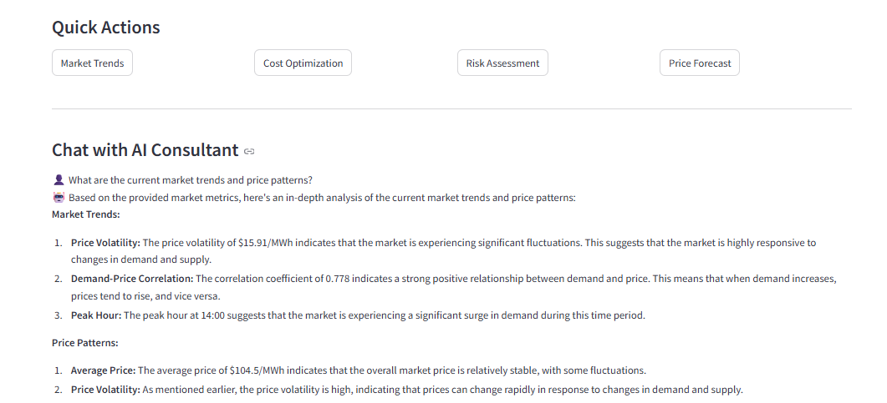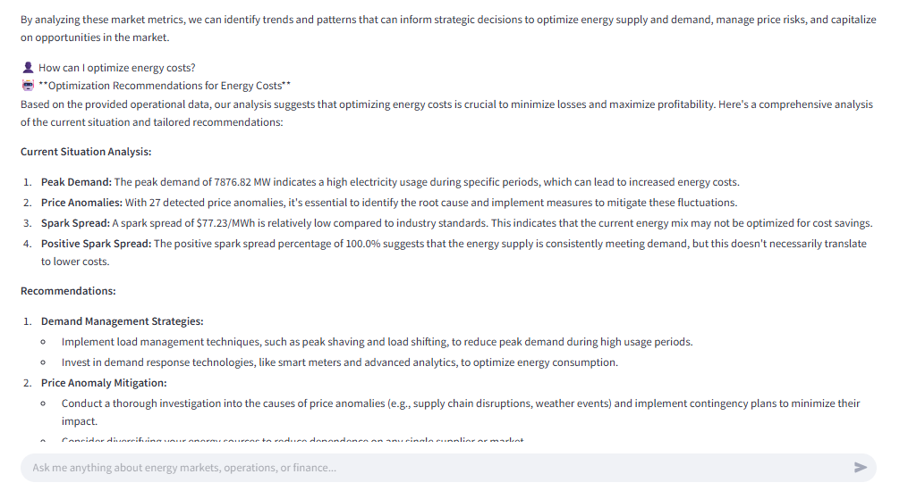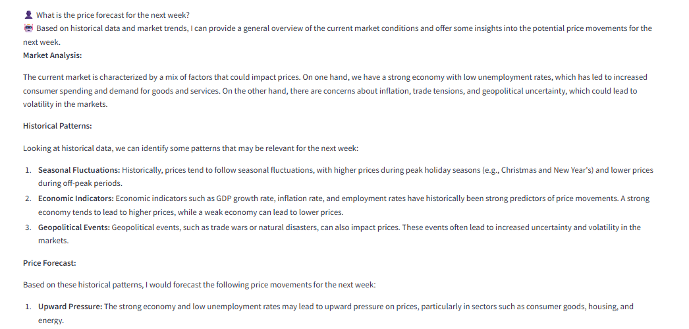

<strong>Reference:</strong> Streamlit implementation of AI Consultant and plus AI Energy Analytic in notebook repository.

<h2>10. Results & Business Insights</h2>
<ul>
<li><strong>Demand:</strong> Average demand of <strong>4,559 MW</strong> with strong seasonal and hourly patterns.</li>
<li><strong>Market Risk:</strong> Average price of <strong>105 CAD/MWh</strong> with <strong>1,020 price spikes</strong> detected.</li>
<li><strong>Forecasting:</strong> LSTM achieved <strong>R² = 0.92</strong> and <strong>RMSE = 13.8 MW</strong>.</li>
<li><strong>Weather:</strong> Extreme temperatures from <strong>-40°C to 44°C</strong> were identified as important demand drivers.</li>
<li><strong>Industrial Load:</strong> Represents approximately <strong>42%</strong> of total demand, providing a major optimization opportunity.</li>
<li><strong>Renewables:</strong> Wind averages <strong>250 kWh</strong> and solar <strong>151 kWh</strong>, highlighting renewable intermittency.</li>
</ul>
<h3>Business Problems Solved</h3>
<ul>
<li>Energy demand and price forecasting</li>
<li>Market volatility and anomaly detection</li>
<li>Energy procurement and cost optimization</li>
<li>Renewable and weather uncertainty</li>
<li>Manual energy analysis and reporting</li>
<li>Data-to-decision gap for energy stakeholders</li>
</ul>
<h3>Business Impact</h3>
<ul>
<li><strong>5–10%</strong> potential energy-cost reduction through load shifting and procurement optimization.</li>
<li>Earlier identification of price and demand risks using VaR and anomaly detection.</li>
<li>Faster decision-making through automated analytics and AI-generated insights.</li>
<li>Natural-language access to complex energy intelligence for technical and non-technical users.</li>
</ul>
<h3>Recommended Solutions</h3>
<ul>
<li>Hybrid procurement and demand-response strategies.</li>
<li>Peak-load shifting and industrial energy optimization.</li>
<li>Real-time weather and market-data integration.</li>
<li>Renewable generation and storage optimization.</li>
<li>Automated AI alerts for market and operational risks.</li>
</ul>
<h3>What the Platform Also Does & Solves</h3>
<ul>
<li><strong>Forecasts:</strong> Demand, price, and gas-market behavior.</li>
<li><strong>Analyzes:</strong> EDA, seasonality, weather, renewable generation, and market drivers.</li>
<li><strong>Detects:</strong> Anomalies, price spikes, volatility, and operational risks.</li>
<li><strong>Optimizes:</strong> Procurement, load shifting, peak demand, and energy costs.</li>
<li><strong>Explains:</strong> Converts analytical results into business insights using LLMs.</li>
<li><strong>Consults:</strong> Provides natural-language Q&A through a multi-agent AI Energy Analyst.</li>
</ul>

<h2>11. Technologies</h2>

<strong>Python, SQL, Pandas, NumPy, Streamlit, Scikit-learn, XGBoost, TensorFlow/Keras, LSTM, GRU, ARIMA, SARIMA, Prophet, LangChain, Ollama/Llama, SQLAlchemy, Matplotlib, Seaborn, and Multi-Agent AI.</strong>

<h2>12. Future Improvements</h2>
<ul>
<li>Real-time IoT, weather, and energy-market data integration.</li>
<li>Improve the platform speed and cover Q&A to answer more technical question.</li>
<li>Adding RAG system to able consider technical and pdf document, reports</li>
<li>Reinforcement-learning-based energy optimization.</li>
<li>Cloud deployment and MLOps.</li>
</ul>

<h2>13. Conclusion</h2>

The <strong>AI-Driven Energy Intelligence Platform</strong> successfully bridges the gap between raw energy data and executive decision-making by integrating data engineering, machine learning, statistical risk analytics, and generative AI into a unified intelligence system.

<strong>Key Achievements:</strong>

<ul>
<li><strong>Risk Intelligence:</strong> Detected 1,020+ price spikes and 602 anomalies for proactive risk management</li>
<li><strong>Cost Optimization:</strong> 5-10% potential energy cost reduction through load shifting and strategic procurement</li>
<li><strong>Decision Support:</strong> Multi-agent AI consultant delivering actionable insights in natural language</li>
</ul>

<strong>Business Impact:</strong>

<ul>
<li>Transforms reactive reporting into proactive intelligence</li>
<li>Democratizes data access through natural language SQL and Q&A</li>
<li>Accelerates decision-making from weeks to minutes</li>
<li>Enables smarter procurement, risk management, and sustainability</li>
</ul>

The platform moves energy analytics from <strong>"What happened?"</strong> to <strong>"What will happen?"</strong> and ultimately <strong>"What should we do?"</strong>—delivering predictive, prescriptive, and actionable intelligence for a smarter, more sustainable energy future.

